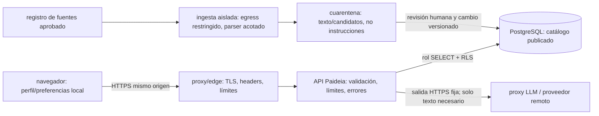

# Modelo de amenazas — Paideia

**Estado:** diseño propuesto, no implementado ni validado en una aplicación. **No es una certificación ni una prueba de seguridad.** Ver controles atómicos y criterios de aceptación en [`controles.json`](./controles.json), respuestas en [`contratos-error.md`](./contratos-error.md) y datos de prueba inertes en [`fixtures/seguridad-inerte.json`](./fixtures/seguridad-inerte.json).

## Contexto, alcance y decisiones abiertas

Paideia se plantea como web educativa en español para público adulto en España; presupuesto 0 €, plazo de una semana y posible pico de 100 usuarios concurrentes, incluidos equipos bajo una misma NAT de aula. No hay login; el perfil se mantiene local; PostgreSQL es una opción para el catálogo; se contempla LLM remoto y fuentes externas/PDF. No hay pagos, operaciones, contratación, transacciones ni recogida intencional de PII real. No existe aplicación ni prueba de carga previa.

Los documentos de origen dejan una decisión funcional abierta: [`docs/REQUISITOS.md`](../../REQUISITOS.md) solicita LLM con contexto del perfil y productos concretos; [`docs/investigacion/10-seguridad-calidad.md`](../../investigacion/10-seguridad-calidad.md) recomienda para el MVP chat externo desactivado, catálogo de demostración y simulaciones ficticias. Este diseño adopta la opción de menor exposición: **sin perfil ni importes en solicitudes al LLM; chat externo desactivado por defecto; catálogo no publicado hasta decidir fuente/licencia/actualidad; no hay endpoint de contratar, lead, pago o transacción**. Si se decide otra cosa, requiere revisión explícita de alcance, privacidad y controles antes de habilitarse.

No se han hecho llamadas a proveedores, solicitudes de red de prueba, análisis de código, instalación, despliegue, pruebas de ataque ni carga. Los casos siguientes son criterios para una futura ejecución en entorno propio y fixtures JSON inertes.

## Activos, actores y confianza

**Activos a proteger:** clave y presupuesto del proveedor; integridad y procedencia del catálogo; contenido/estado del perfil local y entradas hipotéticas; disponibilidad del sitio; permisos de Postgres; secretos de despliegue/repositorio; política de herramientas; reputación y claridad de que la simulación no contrata.

**Actores y fallos considerados:** visitante honesto o abusivo sin autenticación; varias personas detrás de una IP/NAT compartida; contenido hostil o defectuoso de una página/PDF externa; salida equivocada/manipulada del LLM; proveedor agotado/no disponible; error de configuración o de publicación. La prompt injection directa e indirecta se considera posible: las mitigaciones limitan impacto, no garantizan detectarla o eliminarla.[1]

Las flechas son fronteras distintas. El navegador **nunca** recibe credenciales de Postgres/proveedor ni llama directamente a esos sistemas. La ingesta no es una herramienta del modelo ni un endpoint de URL arbitraria. El perfil y las cifras del simulador no cruzan la frontera de red. El chat, si se habilita en el futuro, transmite texto escrito por la persona a un proveedor aún por seleccionar y requiere aviso y revisión de tratamiento/retención/región; mientras eso no se resuelva permanece desactivado.[12]

## Priorización de amenazas

| Prioridad | Amenaza y frontera | Daño posible | Controles decisivos | Criterio mínimo de aceptación |
|---|---|---|---|---|
| **P0** | Prompt injection en texto, catálogo o PDF; salida intenta invocar funciones o sacar contenido | Divulgación/manipulación; uso fuera de finalidad | C03–C04, C06–C07: sin secretos/contexto financiero; tools desactivadas salvo lista cerrada de lectura; validar salida; no ejecutar ni creer instrucciones externas | Fixtures `PI-*`/`TOOL-*`: 0 llamadas no autorizadas, 0 escrituras, 0 secreto/PII; contenido se conserva como dato inerte. No exigir “detección total”.[1][2][3] |
| **P0** | Abuso de ingesta o URL/PDF que causa SSRF | Acceso a loopback, red privada, metadatos o servicios internos | C05–C06: URLs seleccionadas desde registro curado, HTTPS y destinos aprobados; comprobación del IP conectado; redirecciones deshabilitadas; límites y aislamiento de parser | Fixtures `SSRF-*` pasan sin petición de red; allowlist/DNS/redirect rechazados por stub; límites de parseo causan rechazo controlado.[5] |
| **P0** | SQL injection o herramienta expansiva desde usuario/LLM | Lectura fuera de catálogo o modificación/borrado | C02–C04: rol solo SELECT, RLS fail-closed, consultas parametrizadas; nunca aceptar SQL libre; ninguna tool de escritura | `SQL-*`, `DB-*`, `TOOL-*`: resultado se trata como un valor; tabla/policy no cambia; el rol no puede ejecutar DML/DDL/TRUNCATE ni saltarse RLS.[2][6][7][8] |
| **P0** | 100 personas comparten IP/NAT; ráfaga/uso automatizado agota proveedor o hace indisponible la web | Bloqueo injusto de clase, factura/cupo agotado, denegación del servicio | C10–C11, C14: cuotas por sesión opaca + presupuesto y concurrencia globales; IP no es identidad ni límite duro normal; catálogo/cálculo desacoplados del chat | Con 100 sesiones sintéticas tras una sola IP de prueba no hay 429 por IP; se aplican cuotas por sesión y techo global; catálogo sigue respondiendo y la saturación LLM usa fallback explícito.[4][11] |
| **P0** | XSS al renderizar Markdown/HTML de salida o documentos | Ejecución en navegador, robo de perfil local o llamadas no autorizadas | C07: texto por defecto; Markdown reducido, sin HTML; enlaces controlados; CSP HTTP estricta y escapado contextual | `HTML-*`: el DOM contiene texto sin nodos activos, no hay carga externa y la política aparece en todas las respuestas, también errores.[3][9][10] |
| **P0** | Clave en bundle, historial Git, logs, mapas fuente o error | Consumo ajeno, coste y abuso de proveedor | C08: secreto solo en backend; nunca versionado ni devuelto; rotación/revocación; búsqueda previa a publicar | `SECRET-*`: marcador ficticio ausente en artefactos cliente, respuestas y logs; sólo servidor puede autenticarse.[12] |
| **P0** | Timeout/reintentos de POST al LLM duplican coste o bloquean workers | Gasto duplicado y degradación de web | C11–C12: deadline total, cero retry automático, breaker, off-switch; fallback independiente | `UPSTREAM-*`: una invocación máxima por petición; tras timeout/429 no hay retry; apagado corta llamadas nuevas y no bloquea catálogo.[4][11] |
| **P0** | Perfiles/importes o texto sensible se envían/registran por error | Exposición al proveedor/logs, contradicción con uso sin login | C09/C12: contexto mínimo; no adjuntar perfil/escenarios; logs sin cuerpo, headers o prompts; aviso claro | `PRIV-*`: valores sintéticos no aparecen en petición simulada, URL, storage backend, logs ni error; borrado local deja el perfil vacío. |
| **P1** | PDF malformado, enorme, con adjuntos/acciones/texto invisible | CPU/memoria agotada; contenido hostil incorporado al prompt/catálogo | C06: sólo proceso aislado; tipo por contenido, límites de tamaño/páginas/tiempo, texto extraído en cuarentena y revisión humana | `PDF-*`: entradas simuladas excesivas/activas se rechazan o quedan sólo en cuarentena, nunca ejecutadas ni publicadas automáticamente. |
| **P1** | Fuente/licencia/fecha obsoleta o error de extracción | Comparación educativa engañosa | C15: procedencia por campo, versionado y aprobación de publicación | `INGEST-*`: ningún candidato sin source ID, fecha, hash y aprobación puede aparecer en catálogo publicado. |
| **P1** | Desconfiguración de proxy, headers, modo de chat o rol de BD | Exposición transversal no advertida | C01–C02/C07/C16: configuración fail-closed, revisión de headers/grants y evidencia prepublicación | Checklist P0 firmado con artefactos de staging/config; una incógnita crítica equivale a NO PUBLICAR. |

## Controles de arquitectura por frontera

1. **Navegador → proxy → API (C01, C09, C10, C14).** Un origen público HTTPS sirve SPA y API mismo origen; CORS no refleja `Origin`; sólo métodos/rutas esperados y límites de tamaño. `X-Forwarded-For` sólo se acepta del proxy de confianza, que elimina cabeceras aportadas por cliente. Perfil/preferencias se guardan localmente y se borran; importes de simulación sólo en memoria. No hay sesión de usuario/login. Si la API crea identificador anónimo para cuotas, usar token aleatorio no identificativo, cookie `Secure; HttpOnly; SameSite=Lax`, expiración breve y firma/validación server-side; no tratarlo como autenticación.
2. **API → PostgreSQL (C02–C03).** Identidad de ejecución distinta del owner/migrador, `NOSUPERUSER`, `NOBYPASSRLS`, sin DDL/DML, `SELECT` mínimo; RLS habilitada y forzada sobre catálogo, con política sólo para registros publicados. PostgreSQL advierte que owner suele saltarse RLS salvo `FORCE`, y que superuser/`BYPASSRLS` la ignoran; por eso el test debe conectarse con el rol real de la app, no con el owner.[6] La política RLS aquí filtra visibilidad pública, **no** crea identidad por alumno: no hay filas de perfil en servidor. Consultas estáticas parametrizadas; nombres de tablas/columnas/ordenación sólo de mapas constantes; nunca evaluar SQL escrito por usuario/LLM.[7][8]
3. **API → herramientas/LLM (C03–C04, C08–C12).** El modo inicial no expone tools. Si se habilitan posteriormente, el único diseño admisible es lista explícita de búsqueda/ficha de catálogo en lectura, con JSON Schema cerrado (`additionalProperties: false`), límites, enums/IDs existentes y dispatch a funciones de aplicación predeterminadas. Rechazar tool desconocida, JSON inválido/campos extra; no “reparar” con otro prompt. No ofrecer SQL, shell, URL/fetch, filesystem, escritura, contratación, pagos o cambio del catálogo. La autorización se ejecuta en la aplicación/BD, no se delega al modelo; minimizar permisos reduce el daño aunque el modelo sea manipulado.[2]
4. **API → proveedor LLM (C08, C10–C12).** Sólo salida backend a endpoint/modelo fijado por operador, TLS y secreto de servidor; nunca dirección o modelo de proveedor dictados por el usuario. Enviar sólo mensaje necesario, sin perfil local/importes/sesión secreta. Chat desactivado hasta seleccionar proveedor, coste, región, retención, condiciones y aviso. Los límites propios no se sustituyen por el plan de rate limit del proveedor; se requiere gasto máximo interno además de cuotas del proveedor.[4][11][12]
5. **Fuentes → ingesta (C05–C06, C15).** No aceptar URL de usuario/LLM/PDF para descargar. Ingesta off por defecto; operador mantiene registro fijo de orígenes y cada artefacto se revisa/licencia y fecha. Sólo HTTPS, hostname exacto aprobado, resolver y validar dirección pública en el punto de conexión, bloquear IPv4/IPv6 privados, loopback, link-local, multicast, metadata y nombres internos, impedir DNS rebinding y desactivar redirecciones (o revalidar cada salto; decisión preferida: no seguirlas). Egreso de red bloquea redes internas aun si falla validación de aplicación.[5] PDF a proceso aislado sin red, límites iniciales propuestos 10 MiB, 50 páginas y 10 s de parseo; extraer texto/metadata sin ejecutar acciones/adjuntos, cuarentena y revisión humana. Si hosting no puede hacer ese aislamiento, no activar ingesta PDF.
6. **Respuesta → navegador (C07, C12).** Renderizar respuesta como texto escapado. Si Markdown es imprescindible: lista reducida de elementos, HTML crudo deshabilitado, URLs `https` de hosts aprobados, sin imágenes, SVG, iframe, forms o atributos `on*`; sanitizar HTML final con versión revisada de sanitizador. CSP enviada como header por edge/hosting para toda respuesta: `default-src 'none'; script-src 'self'; style-src 'self'; img-src 'self'; connect-src 'self'; font-src 'self'; base-uri 'none'; object-src 'none'; frame-ancestors 'none'; form-action 'self'; upgrade-insecure-requests`. Evitar `unsafe-inline`/`unsafe-eval`; adaptar assets con nonces/hashes sólo con revisión. CSP es capa adicional, no sustituto de encoding/sanitización.[3][9][10]
7. **Repos/operación (C08, C11, C16).** Secretos fuera del cliente, commits, `.env` versionado, mapas fuente, logs y fixtures; separar dev/prod, acceso mínimo, rotar/revocar. Antes de publicar revisar árbol y artefactos de distribución, historial accesible, configuración del host y source maps; scanner de secretos no sustituye revisión. Logs guardan timestamp, `request_id`, código de error, latencia, tokens/coste agregados y motivo de breaker; no cuerpo, prompt, salida, cookie, Authorization, query SQL ni IP completa de rutina.

## Cuotas, disponibilidad y fallback (C10–C12, C14)

Valores de partida **propuestos y pendientes de aprobación/medición**, no medidos: mensaje ≤4.000 caracteres; respuesta ≤500 tokens; 5 solicitudes por minuto y 30 por día por sesión anónima; máximo 12 llamadas LLM simultáneas; presupuesto global de 300 llamadas/día más tope diario y mensual en euros **numérico, no nulo y aprobado para el proveedor elegido**. Ajustar antes de activar; ausencia de cualquiera de los topes de gasto desactiva el chat. Reservar gasto/token antes de llamar y contabilizar; si el proveedor no informa uso en fallo, computar el máximo reservado. El presupuesto global prevalece sobre cuotas locales.

El límite por sesión busca equidad; la cuota/techo global limita gasto y concurrencia. Una IP compartida no es una sesión: **no aplicar cuota dura normal por IP**. IP puede ser señal secundaria de ráfaga con umbral que tolere la clase y revisión; no limitar un aula completa por compartir NAT. Cualquier rechazo por concurrencia/presupuesto es por alcance global, con fallback legible, y no interrumpe catálogo/cálculo local. El test de 100 sesiones separa rechazos por IP de la saturación global, no promete 100 llamadas al LLM si presupuesto/concurrencia no las permiten.[4]

Timeout propuesto: conexión 3 s, deadline total por invocación 15 s, cuerpo de salida ≤32 KiB; confirmar lo soportado por SDK/proveedor. `maxRetries=0` (incluidos reintentos del SDK, proxy y frontend); una solicitud expirada pudo haber sido recibida/cobrada y la interfaz no debe afirmarlo en contrario. Reintento sólo manual, con nueva decisión del usuario. Si el proveedor devuelve 429/503, timeout, el breaker abre o se agota el budget: no retry automático; mostrar error tipado y mantener resto de la web. `PAIDEIA_CHAT_ENABLED=false` es default/off-switch global; deshabilita llamadas nuevas aunque el SDK esté configurado. El contrato completo está en [`contratos-error.md`](./contratos-error.md).

## Invariantes verificables antes de publicar

- No hay route/end-point/función tool que escriba, contrate, pague, cree usuario/lead, ejecute SQL arbitrario, haga fetch de URL arbitraria o ejecute código.
- Cuenta del proceso web/LLM no puede escribir en catálogo ni evadir RLS. Ingesta de MVP sólo produce candidato aislado; publicación es revisión humana + cambio versionado con identidad separada.
- Se prueba con 100 sesiones sintéticas tras una sola IP TEST-NET que no exista un bloqueo por IP; la tolerancia del proveedor, límites globales y catálogo se prueban con doble simulado en staging propio únicamente. No se ejecuta aquí.
- Fixtures inertes nunca se envían a proveedor, se ejecutan como HTML/SQL ni realizan conexiones. Pruebas SSRF futuros usan resolver/HTTP stub o red aislada propia; no destinos reales.
- Prompt injection puede cambiar el texto del LLM; criterio de seguridad es que no concede permisos, no divulga secretos no incluidos, no revela datos ajenos ni ejecuta acciones. No se promete eliminación total.[1]
- Por ausencia de app, staging y load test, los controles y criterios de aceptación siguen **pendientes**. No afirmar capacidad para 100 concurrentes hasta medir en staging propio conforme al checklist.

## Evidencia primaria

Estos extractos de OWASP, PostgreSQL y el proveedor ilustran la base de diseño; no demuestran que Paideia implemente los controles.

- OWASP indica que «it is unclear if there are fool-proof methods of prevention for prompt injection»; por eso el criterio es contención y no una promesa de eliminación/detección total.[1]
- OWASP recomienda: «Limit the extensions that LLM agents are allowed to call to only the minimum necessary»; Paideia no da herramientas de escritura ni funciones abiertas.[2]
- PostgreSQL advierte: «Superusers and roles with the `BYPASSRLS` attribute always bypass the row security system when accessing a table»; por eso se verifica el rol runtime real y su atributo.[6]
- OWASP SSRF pide desactivar el seguimiento de redirecciones o proteger cada salto; el diseño elige no seguirlas.[5]
- OpenAI documenta que «Rate limits are defined at the organization level and at the project level, not user level»; la cuota por sesión y el presupuesto global de Paideia deben complementar los límites del proveedor.[11]
- OpenAI advierte: «Remember that your API key is a secret! Do not share it with others or expose it in any client-side code (browsers, apps).»; por eso la clave sólo se carga en servidor.[12]
- OWASP recomienda usar `textContent` para mostrar texto y señala que CSP no debe ser la única defensa XSS; se combinan texto/Markdown acotado, sanitización y CSP.[9][10]

La lista de URLs de estas fuentes primarias se genera a continuación desde el registro de citas. Para los antecedentes de producto, véanse los dos documentos locales citados en el apartado de alcance.

## Sources

[1] https://genai.owasp.org/llmrisk/llm01-prompt-injection
[2] https://genai.owasp.org/llmrisk/llm062025-excessive-agency
[3] https://genai.owasp.org/llmrisk/llm052025-improper-output-handling
[4] https://owasp.org/API-Security/editions/2023/en/0xa4-unrestricted-resource-consumption
[5] https://cheatsheetseries.owasp.org/cheatsheets/Server_Side_Request_Forgery_Prevention_Cheat_Sheet.html
[6] https://www.postgresql.org/docs/current/ddl-rowsecurity.html
[7] https://www.postgresql.org/docs/current/libpq-exec.html
[8] https://cheatsheetseries.owasp.org/cheatsheets/SQL_Injection_Prevention_Cheat_Sheet.html
[9] https://cheatsheetseries.owasp.org/cheatsheets/Content_Security_Policy_Cheat_Sheet.html
[10] https://cheatsheetseries.owasp.org/cheatsheets/Cross_Site_Scripting_Prevention_Cheat_Sheet.html
[11] https://developers.openai.com/api/docs/guides/rate-limits
[12] https://platform.openai.com/docs/api-reference/authentication
